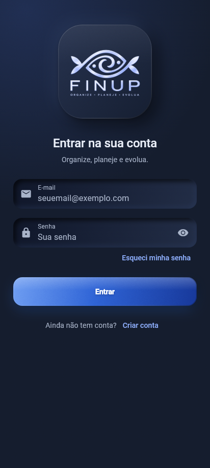

# Relatório de Teste 04 — Teste de persistência: os dados continuam salvos após reiniciar?

| Item | Valor |
|---|---|
| Projeto | FinUp — Sistema de Gestão Financeira |
| Tipo de teste | Persistência e durabilidade |
| Escopo | Dados no servidor (arquivo SQLite) e dados no aparelho (login e tema), depois de reiniciar o app, a API ou os dois |
| Data/hora da execução | 08/11/2026 00:59 (UTC−3) |
| Versão testada | branch `redesign-fusao-tema-escuro`, commit `e1376b8` + alterações locais não commitadas |
| Executado por | millanzz (com apoio do Claude Code) |
| Resultado geral | **14 de 14 casos aprovados (100%)**: 43 verificações nas 3 fases do app + 4 testes de queda da API. Nenhum defeito novo |


> **Reteste após as correções (2º ciclo).** Este relatório registra o **1º ciclo** de testes, com as falhas como foram encontradas; as evidências dele estão em [evidencias-ciclo1/](evidencias-ciclo1/). Os defeitos foram corrigidos e as baterias foram executadas de novo: os resultados novos estão em [evidencias/](evidencias/) e o comparativo antes × depois, em [../RETESTE.md](../RETESTE.md).

---

## 1. O que precisa sobreviver a um reinício

No FinUp, os dados ficam guardados em dois lugares:

| Onde | O que fica guardado | Como |
|---|---|---|
| **Servidor** | usuários, senhas (hash), categorias, receitas, despesas, parcelas, metas | arquivo SQLite gravado pela API (`backend/src/database/db.js`) |
| **Aparelho** | token de login (sessão) e tema escolhido | `shared_preferences` (`ApiClient` e `ThemeController`) |

O teste reinicia os dois lados e confere se nada se perde, se nada muda sozinho e se o que foi excluído não volta.

## 2. Como o teste foi montado

**Nenhum arquivo do projeto foi alterado.** O `backend/database.db` não foi aberto: a data de modificação dele continua sendo 07/11/2026 15:42.

Para ser um reinício de verdade, e não uma simulação em memória:

- **Cada fase do app é um processo separado.** A memória do app começa vazia em cada fase, exatamente como ao fechar e abrir o app.
- **As preferências do aparelho vão para um arquivo real.** O teste usa a implementação Windows do `shared_preferences`, a mesma que o app usaria rodando no Windows, gravando em [evidencias/aparelho/](evidencias-ciclo1/aparelho/) em vez do AppData.
- **Entre as fases, a API é derrubada à força** (`kill -9`, sem fechar o banco) e iniciada de novo sobre o mesmo arquivo SQLite.
- Ao abrir, o teste repete o que o `main()` do app faz: carrega o tema, restaura a sessão e carrega os dados.

Linha do tempo real da execução ([linha-do-tempo.txt](evidencias-ciclo1/linha-do-tempo.txt)):

```
00:59:31  API iniciada (pid 893)
00:59:31  FASE 1 — app usa, cria/edita/exclui dados e escolhe o tema escuro → processo encerrado
00:59:41  API derrubada à força
00:59:43  API iniciada (pid 924)
00:59:43  FASE 2 — app reaberto do zero: compara tudo com a fase 1 e sai da conta → processo encerrado
00:59:53  API derrubada à força
00:59:54  API iniciada (pid 949)
00:59:54  FASE 3 — app reaberto do zero depois de sair: abre no login, entra e compara de novo
01:00:02  API derrubada à força
          comparação do arquivo SQLite: fim da fase 1 × fim do teste
          durabilidade: 14 quedas forçadas da API durante e logo após gravações
```

## 3. Dados criados na fase 1 (pelos serviços do app)

| Tipo | Ações |
|---|---|
| Conta | cadastro de "Paula Mendes" → nome editado para "Paula M. Ribeiro" → senha trocada |
| Aparelho | tema escuro escolhido |
| Receitas | Salário R$ 5.200; "Logo — padaria São João" R$ 850,50 numa categoria **criada pelo usuário** ("Projetos") |
| Despesas | Aluguel R$ 1.450; Mercado R$ 380,40 **editado** para "Mercado do mês" R$ 412,90; Cinema R$ 45 **excluído**; Notebook R$ 3.600 em **4x**, com a **2ª parcela excluída** |
| Metas | Reserva de emergência (R$ 2.000 + aportes de R$ 500 e R$ 250,75); Viagem; Carro **excluída** |

O estado completo depois disso foi guardado em [estado-antes-de-reiniciar.json](evidencias-ciclo1/estado-antes-de-reiniciar.json). As fases seguintes comparam com ele.

## 4. Resumo dos resultados

| Grupo | Casos | Aprovados | Reprovados |
|---|---:|---:|---:|
| Reinício do app e da API (fases 1 a 3) | 10 | 10 | 0 |
| Durabilidade da API + SQLite (quedas forçadas) | 4 | 4 | 0 |
| **Total** | **14** | **14** | **0** |

## 5. Casos de teste

Legenda: ✅ aprovado. Cada verificação, com o valor esperado e o obtido, está no [diário da execução](evidencias-ciclo1/diario.md).

### 5.1 Reinício do app e da API

| ID | O que deve continuar salvo | Onde foi verificado | Resultado | Status |
|---|---|---|---|---|
| CT-PER-01 | **Tema escolhido** | Arquivo do aparelho nas fases 1, 2 e 3; `ThemeController.carregar()` ao reabrir | `"theme_mode": "dark"` no arquivo; app reabre no escuro, inclusive depois de sair da conta | ✅ |
| CT-PER-02 | **Sessão (token)** | Arquivo do aparelho; `restaurarSessao()` num processo novo | Token presente no arquivo; o app reabre direto na Início, sem pedir login | ✅ |
| CT-PER-03 | **Perfil editado** | `/users/me` e `AuthService.nome` após reabrir | "Paula M. Ribeiro" (não volta para o nome do cadastro) | ✅ |
| CT-PER-04 | **Senha trocada** | Login nas fases 2 e 3 | Senha nova entra (200); senha antiga continua recusada (401) | ✅ |
| CT-PER-05 | **Receitas e despesas**, inclusive a editada e as parcelas | `/incomes` e `/expenses` comparados **campo a campo** (id, valor, data, descrição, categoria, grupo e número da parcela, `created_at`) | Idênticos à fase 1, nas fases 2 e 3 | ✅ |
| CT-PER-06 | **Exclusões continuam excluídas** | Consulta direta ao SQLite pelos ids excluídos | Cinema, 2ª parcela do Notebook e meta Carro continuam fora do banco | ✅ |
| CT-PER-07 | **Metas e aportes** | `/goals` e `MetaService` | Reserva com R$ 2.750,75 e ícone `wallet`; Viagem com `flight`; iguais à fase 1 | ✅ |
| CT-PER-08 | **Categorias**, inclusive a criada pelo usuário | `/categories` e SQLite | Lista idêntica; "Projetos" (receita) persistiu | ✅ |
| CT-PER-09 | **Saldos e tela inicial** | `/dashboard`, `/dashboard?month=2026-11`, `LancamentoService.saldo` e **comparação pixel a pixel** da tela Início | Valores idênticos; a tela reaberta é **igual pixel a pixel** à da fase 1 | ✅ |
| CT-PER-10 | **Sair da conta e reabrir** | Arquivo do aparelho após sair; abertura na fase 3; arquivo SQLite no fim | Token apagado do disco e tema mantido; app abre no **login** (tema escuro); ao entrar, os dados estão intactos; banco **idêntico** ao da fase 1 (mesmo SHA-256) e `integrity_check = ok` | ✅ |

**Capturas** (fase 1 × fase 2 × fase 3):

| Antes de reiniciar | Depois de reiniciar app + API | Depois de sair da conta e reabrir |
|---|---|---|
|  |  |  |

### 5.2 Durabilidade da API + SQLite

Aqui a API é derrubada à força, sem chance de fechar o banco, como num travamento do servidor.

| ID | Cenário | Resultado | Status |
|---|---|---|---|
| CT-PER-11 | 10 gravações (receitas, despesas e metas), cada uma seguida de **queda imediata** da API logo após o "201 Created" | 10 confirmadas, 10 encontradas, com os mesmos valores, após 10 quedas | ✅ |
| CT-PER-12 | **Queda no meio** de 300 gravações simultâneas | 26 gravações tinham sido confirmadas antes da queda; 48 estavam no banco depois. **Nenhuma confirmada se perdeu.** As não confirmadas foram cortadas pela queda, como esperado. Banco íntegro | ✅ |
| CT-PER-13 | 3 reinícios seguidos **sem gravar nada** | Conteúdo das tabelas e SHA-256 do arquivo **idênticos**: as migrações do `db.js` não alteram dados existentes | ✅ |
| CT-PER-14 | Estado do arquivo depois de 14 quedas | `integrity_check = ok`, sem violações de chave estrangeira, `foreign_keys = 1`, `journal_mode = delete`; o login do usuário continua funcionando | ✅ |

## 6. Defeitos e observações

**Nenhum defeito novo.** Observações:

| ID | Observação |
|---|---|
| OBS-07 | O saldo geral salvo e relido é `1487.6000000000004`: o mesmo resíduo de ponto flutuante do **DEF-01** (Relatório 01). A persistência guarda e devolve exatamente o mesmo valor; o resíduo vem da soma, não do armazenamento. |
| OBS-08 | **Limites do teste.** A "queda" é do processo da API (como um travamento ou `kill -9`), não uma queda de energia da máquina. Para queda de energia, o SQLite depende do sistema operacional gravar o cache no disco. O modo `journal_mode = delete` (padrão) é seguro para isso. |
| OBS-09 | **Limites do teste.** As preferências foram testadas com a implementação **Windows** do `shared_preferences`. No Android e no iOS o app usa o armazenamento nativo de cada sistema, pelo mesmo código (`SharedPreferences.getInstance()`). O comportamento do app é o mesmo, mas o arquivo físico é outro. |

## 7. Evidências

Na pasta [evidencias-ciclo1/](evidencias-ciclo1/):

| Arquivo | Conteúdo |
|---|---|
| [diario.md](evidencias-ciclo1/diario.md) | **As 43 verificações das fases**, cada uma com o esperado e o obtido, e o número do processo de cada fase (prova de que eram processos diferentes) |
| [linha-do-tempo.txt](evidencias-ciclo1/linha-do-tempo.txt) | Horário de cada subida, queda e fase |
| [estado-antes-de-reiniciar.json](evidencias-ciclo1/estado-antes-de-reiniciar.json) | Estado completo no fim da fase 1, usado como referência |
| [aparelho/shared_preferences.json](evidencias-ciclo1/aparelho/shared_preferences.json) | O arquivo real de preferências do "aparelho" no fim do teste (só o tema, já que a conta foi encerrada) |
| [banco-persistencia.db](evidencias-ciclo1/banco-persistencia.db) | O arquivo SQLite usado nas fases |
| [banco-apos-fase1.sql](evidencias-ciclo1/banco-apos-fase1.sql), [banco-final.sql](evidencias-ciclo1/banco-final.sql) e [comparacao-banco.txt](evidencias-ciclo1/comparacao-banco.txt) | Conteúdo do banco antes e depois dos reinícios, e o resultado da comparação (idêntico, mesmo SHA-256) |
| [telas/](evidencias-ciclo1/telas/) | Capturas das fases e a referência da comparação pixel a pixel |
| [banco-durabilidade.db](evidencias-ciclo1/banco-durabilidade.db) e [durabilidade-log.txt](evidencias-ciclo1/durabilidade-log.txt) | Banco e registro de cada queda e reinício dos testes de durabilidade |
| `saida-fase1.txt`, `saida-fase2.txt`, `saida-fase3.txt`, `saida-durabilidade.txt`, `api-log.txt`, `execucao.txt` | Saídas completas de cada etapa e códigos de saída |

Código: [executar.sh](executar.sh) (orquestra fases e quedas), [flutter/](flutter/) (fases 1 a 3 e suporte do aparelho com arquivo real) e [servidor/durabilidade.test.js](servidor/durabilidade.test.js). A API de teste e o exportador do banco são os da bateria 03 (`testes/03-integracao/servidor/`).

## 8. Como reexecutar

Na raiz do repositório:

```bash
bash testes/04-persistencia/executar.sh
```

## 9. Conclusão

Os dados do FinUp **continuam salvos depois de reiniciar o app, a API ou os dois**:

- tudo o que foi criado, editado ou excluído antes do reinício aparece exatamente igual depois, campo a campo e na própria tela (pixel a pixel);
- o que foi excluído não volta;
- a sessão e o tema ficam no aparelho, e sair da conta remove a sessão do disco;
- no servidor, nenhuma gravação confirmada se perdeu em 14 quedas forçadas, inclusive no meio de gravações simultâneas;
- o arquivo SQLite continuou íntegro;
- reiniciar a API não altera nenhum dado.
