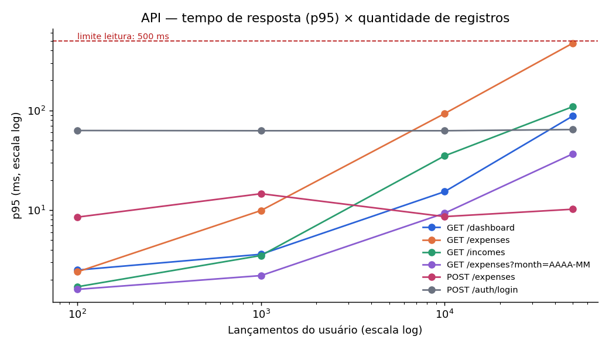
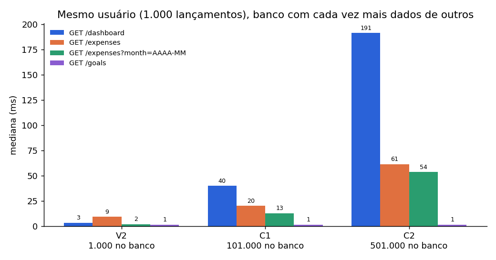
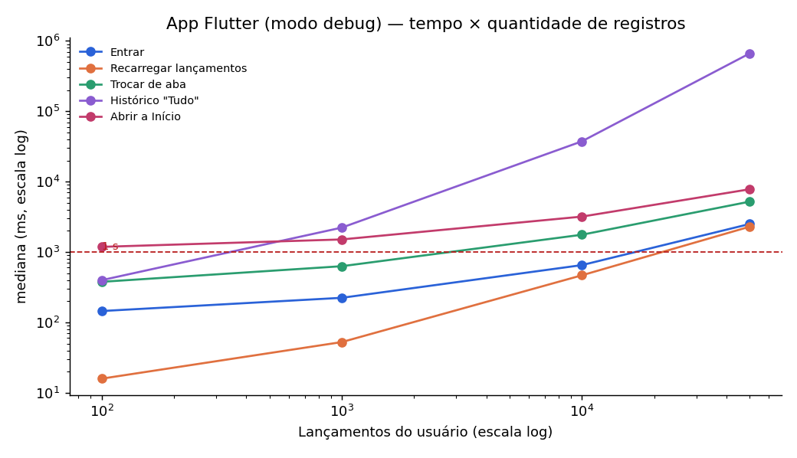

# Relatório de Teste 05 — Teste de desempenho: tempo de resposta × quantidade de registros

| Item | Valor |
|---|---|
| Projeto | FinUp — Sistema de Gestão Financeira |
| Tipo de teste | Desempenho (tempo de resposta, volume e carga simultânea) |
| Escopo | API (todas as rotas principais) e app Flutter (entrar, carregar, abrir a Início, trocar de aba, Histórico) |
| Data/hora da execução | 08/11/2026 01:23 a 02:31 (UTC−3); o cenário V4 foi reexecutado às 02:08 (ver seção 4) |
| Versão testada | branch `redesign-fusao-tema-escuro`, commit `e1376b8` + alterações locais não commitadas |
| Executado por | millanzz (com apoio do Claude Code) |
| Resultado geral | **89 de 102 medições dentro do limite (87%)**. A API responde rápido com uma requisição por vez em todos os volumes, mas **perde desempenho com acessos simultâneos e com o banco crescendo**. No app, **as telas que trabalham com todos os lançamentos ficam lentas a partir de 1.000–10.000 registros**. **4 defeitos novos** (DEF-06 a DEF-09) |


> **Reteste após as correções (2º ciclo).** Este relatório registra o **1º ciclo** de testes, com as falhas como foram encontradas; as evidências dele estão em [evidencias-ciclo1/](evidencias-ciclo1/). Os defeitos foram corrigidos e as baterias foram executadas de novo: os resultados novos estão em [evidencias/](evidencias/) e o comparativo antes × depois, em [../RETESTE.md](../RETESTE.md).

---

## 1. Objetivo

Medir como o tempo de resposta muda conforme cresce a quantidade de registros:

1. **do próprio usuário** (100 → 50.000 lançamentos);
2. **do banco como um todo** (o mesmo usuário com 1.000 lançamentos num banco com até 500 mil lançamentos de outras pessoas);
3. com **20 pessoas usando ao mesmo tempo**.

## 2. Ambiente

| Componente | Detalhe |
|---|---|
| Máquina | Intel Core i5-9400F 2,9 GHz (6 núcleos) · 15,9 GB RAM · SSD Kingston SA400 · Windows 11 Pro |
| API | `backend/src/app.js` real, Node.js v24.11.0, banco em **arquivo** SQLite (schema real do `db.js`) |
| App | Flutter 3.41.1, código real das telas e serviços, rodando pelo `flutter test` (**modo debug**) |
| Rede | Cliente e servidor na mesma máquina (`127.0.0.1`): não há latência de internet nos números |

**Nenhum arquivo do projeto foi alterado.** Os bancos de cada cenário são criados numa pasta temporária, nunca no `backend/database.db`.

## 3. Método

**Dados.** O [semear.js](servidor/semear.js) cria o banco executando o `db.js` real e gera dados com semente fixa, então cada execução gera os mesmos dados:

- 30% receitas e 70% despesas;
- cerca de 10% das despesas em compras parceladas (4 a 12 parcelas);
- datas espalhadas pelos últimos 24 meses;
- 20 metas;
- todas as categorias padrão.

| Cenário | Lançamentos do usuário medido | Lançamentos no banco (total) | Tamanho do banco |
|---|---:|---:|---:|
| V1 | 100 | 100 | 0,0 MB |
| V2 | 1.000 | 1.000 | 0,1 MB |
| V3 | 10.000 | 10.000 | 0,8 MB |
| V4 | 50.000 | 50.000 | 3,8 MB |
| C1 | 1.000 | 101.000 (50 outros usuários) | 7,8 MB |
| C2 | 1.000 | 501.000 (50 outros usuários) | 38,9 MB |

Como referência de volume: uma pessoa que lança 10 movimentações por dia chega a cerca de 3.600 por ano. Ou seja, V3 equivale a uns 3 anos de uso intenso, e V4 é um cenário de estresse.

**API** ([medir-api.js](servidor/medir-api.js), processo separado da API). Para cada rota:

- 3 chamadas de aquecimento e depois 20 chamadas medidas, uma de cada vez;
- o tempo vai do envio da requisição até o fim do corpo da resposta;
- as rotas de escrita criam, editam e excluem o mesmo registro, para que o volume do cenário não mude;
- no fim, **20 requisições simultâneas** ao `/dashboard`, em 5 rodadas.

**App** ([medir_app_test.dart](flutter/medir_app_test.dart)). Usa os serviços e as telas reais, conversando com a API do cenário:

- entrar, como faz a tela de login;
- recarregar os lançamentos, 5 vezes, com o tempo separado em rede e processamento;
- abrir a Início;
- trocar de aba, 6 vezes;
- abrir o Histórico com o filtro "Tudo".

**Critérios de aceitação.** São baseados nos limites clássicos de usabilidade: 0,1 s parece instantâneo, 1 s mantém o fluxo de pensamento e 10 s esgota a atenção.

| Medida | Limite |
|---|---|
| API, leitura (GET), p95 | ≤ 500 ms |
| API, escrita (POST/PUT/DELETE), p95 | ≤ 300 ms |
| API, login, p95 | ≤ 1.000 ms |
| App, trocar de aba e Histórico | ≤ 1 s |
| App, abrir a Início e recarregar dados | ≤ 2 s |
| App, entrar | ≤ 3 s |

> ⚠️ **O app foi medido em modo debug.** Nesse modo o Flutter roda sem otimizações e com verificações extras, então num celular com o app em modo release os tempos absolutos tendem a ser menores. O que vale aqui é **como o tempo cresce com o volume**: um aumento de 2,2 s para 11 minutos não some com a compilação otimizada.

## 4. Execução

[execucao.txt](evidencias-ciclo1/execucao.txt) registra cada etapa:

- a rodada completa terminou com sucesso em 5 dos 6 cenários;
- no V4 (50.000 lançamentos), a medição do app **passou do limite de 20 minutos do próprio teste** e não salvou resultados. O Histórico sozinho levou mais de 11 minutos para mostrar a lista;
- o teste foi ajustado para salvar cada medida assim que termina e para não repetir passos que passam de 30 s. Depois disso, **só o V4 foi reexecutado** (API e app), com sucesso. Os registros das duas tentativas estão em [saida-app.txt](evidencias-ciclo1/saida-app.txt).

## 5. Resultados — API

### 5.1 Uma requisição por vez (p95, ms)

| Rota | V1 (100) | V2 (1 mil) | V3 (10 mil) | V4 (50 mil) | C1 (1 mil / 101 mil no banco) | C2 (1 mil / 501 mil no banco) |
|---|---:|---:|---:|---:|---:|---:|
| `POST /auth/login` | ✅ 62,9 | ✅ 62,6 | ✅ 62,6 | ✅ 74,5 | ✅ 63,9 | ✅ 63,2 |
| `GET /dashboard` | ✅ 2,5 | ✅ 3,6 | ✅ 15,3 | ✅ 85,2 | ✅ 40,5 | ✅ 194,9 |
| `GET /dashboard?month=` | ✅ 2,4 | ✅ 3,6 | ✅ 17,6 | ✅ 99,6 | ✅ 40,6 | ✅ 197,1 |
| `GET /incomes` | ✅ 1,7 | ✅ 3,5 | ✅ 35,0 | ✅ 97,8 | ✅ 5,1 | ✅ 16,3 |
| `GET /expenses` | ✅ 2,4 | ✅ 9,9 | ✅ 93,0 | ✅ 433,3 | ✅ 22,5 | ✅ 62,9 |
| `GET /expenses?month=` | ✅ 1,6 | ✅ 2,2 | ✅ 9,3 | ✅ 51,0 | ✅ 13,1 | ✅ 54,1 |
| `GET /goals` | ✅ 1,6 | ✅ 1,5 | ✅ 14,1 | ✅ 1,5 | ✅ 1,9 | ✅ 2,0 |
| `GET /categories` | ✅ 1,7 | ✅ 1,5 | ✅ 2,3 | ✅ 1,4 | ✅ 1,7 | ✅ 1,9 |
| `POST /expenses` | ✅ 8,5 | ✅ 14,6 | ✅ 8,6 | ✅ 9,2 | ✅ 11,4 | ✅ 27,6 |
| `PUT /expenses/:id` | ✅ 8,2 | ✅ 8,4 | ✅ 7,9 | ✅ 10,1 | ✅ 10,8 | ✅ 25,9 |
| `DELETE /expenses/:id` | ✅ 7,1 | ✅ 7,6 | ✅ 7,7 | ✅ 7,6 | ✅ 10,1 | ✅ 29,6 |

As 66 medições ficaram dentro do limite. Mesmo assim, há duas tendências:

- **O que cresce com o volume do usuário:** `GET /expenses` (de 2 ms para 433 ms, com resposta de **9,8 MB** em V4) e o `/dashboard`.
- **O que cresce com o volume de outros usuários**, mesmo o usuário tendo sempre 1.000 lançamentos: o `/dashboard` vai de 3,6 ms para **195 ms** (54 vezes mais lento) e o filtro por mês vai de 2,2 ms para 54 ms. Esse é o sinal do **DEF-06**.
- **O que não muda com o volume:** login (dominado pelo bcrypt, cerca de 62 ms), escritas (cerca de 7 a 10 ms), metas e categorias.





### 5.2 Vinte pessoas ao mesmo tempo (`GET /dashboard`, 20 simultâneas × 5 rodadas)

| | V1 | V2 | V3 | V4 | C1 | C2 |
|---|---:|---:|---:|---:|---:|---:|
| p95 (ms) | ✅ 23,9 | ✅ 39,4 | ✅ 284,5 | ❌ **1.791** | ❌ **787** | ❌ **3.875,6** |
| Vazão (requisições/s) | 877 | 505 | 74 | 12 | 25 | **5** |

Com acessos simultâneos, o tempo de cada um soma: as consultas são atendidas uma depois da outra (**DEF-07**). No banco com 501 mil lançamentos, cada pessoa espera quase **4 segundos** pelo resumo, mesmo tendo só 1.000 lançamentos.

## 6. Resultados — App (modo debug, mediana em ms)

| Medida | Limite | V1 | V2 | V3 | V4 | C1 | C2 |
|---|---:|---:|---:|---:|---:|---:|---:|
| Entrar (login + carregar dados) | 3.000 | ✅ 145 | ✅ 224 | ✅ 652 | ✅ 2.504 | ✅ 225 | ✅ 290 |
| Recarregar todos os lançamentos | 2.000 | ✅ 16 | ✅ 53 | ✅ 467 | ❌ 2.292 | ✅ 67 | ✅ 119 |
| ↳ rede (download) | | 8 | 15 | 104 | 541 | 28 | 79 |
| ↳ processamento no app (JSON → modelos) | | 5 | 35 | 356 | 1.762 | 35 | 35 |
| Abrir a Início até mostrar o saldo | 2.000 | ✅ 1.185 | ✅ 1.511 | ❌ 3.188 | ❌ 7.800 | ✅ 1.565 | ✅ 1.533 |
| Trocar de aba (até recarregar e redesenhar) | 1.000 | ✅ 378 | ✅ 629 | ❌ 1.762 | ❌ 5.201 | ✅ 747 | ✅ 740 |
| **Histórico → filtro "Tudo"** | 1.000 | ✅ 399 | ❌ **2.226** | ❌ **37.392** | ❌ **663.549 (11 min)** | ❌ 2.149 | ❌ 2.224 |
| Dados baixados a cada recarga | | 24 KB | 243 KB | 2,4 MB | **12,1 MB** | 243 KB | 243 KB |



Leitura dos resultados:

- **Histórico "Tudo"** é o ponto mais crítico (**DEF-08**). O tempo cresce bem mais rápido que o volume: 2,2 s com 1.000 lançamentos, 37 s com 10.000 e 11 minutos com 50.000. Ou seja, 10 vezes mais dados levam 17 vezes mais tempo. Já com 1.000 lançamentos (menos de um ano de uso comum) a tela passa de 1 s.
- **Trocar de aba** sempre baixa e reprocessa **todos** os lançamentos (**DEF-09**): 2,4 MB e 1,8 s por toque com 10.000 lançamentos; 12 MB e 5,2 s com 50.000. O primeiro quadro após o toque é rápido (cerca de 230 ms em V4), mas os números da tela só se atualizam depois da recarga.
- Em V4, **o processamento no app (1,8 s) pesa mais que a rede (0,5 s)**: transformar 12 MB de JSON em objetos custa caro no celular.
- Com o banco compartilhado (C1, C2), o app não muda, porque o usuário continua com 1.000 lançamentos. O impacto de um banco grande aparece na API (seção 5).

## 7. Defeitos encontrados

A numeração continua a dos relatórios anteriores.

### DEF-06 — Faltam índices no banco: consultas de um usuário ficam lentas quando o banco cresce com dados de outros

| Item | Detalhe |
|---|---|
| Evidência | Mesmo usuário com 1.000 lançamentos: `/dashboard` 3,6 ms → 40,5 ms → 195 ms (p95) com 1 mil, 101 mil e 501 mil lançamentos no banco; `/expenses?month=` 2,2 → 13,1 → 54,1 ms |
| Causa | `db.js` não cria índices em `incomes`/`expenses` (nem em `user_id`, nem em `date`). Toda consulta lê a tabela inteira, de todos os usuários |
| Severidade | Média hoje, alta conforme o número de usuários cresce |
| Sugestão | `CREATE INDEX IF NOT EXISTS idx_incomes_user_date ON incomes(user_id, date)` e o mesmo para `expenses` (e `categories(user_id)`, `goals(user_id)`), no próprio `db.js`. Reexecutar os cenários C1 e C2 para confirmar |

### DEF-07 — `/dashboard` não aguenta acessos simultâneos com volume alto

| Item | Detalhe |
|---|---|
| Evidência | 20 acessos simultâneos: p95 de 1,8 s (V4) e 3,9 s (C2); a vazão cai de 877 para 5 requisições/s |
| Causa | Cada `/dashboard` faz 5 consultas que percorrem as tabelas (agravado pelo DEF-06), e a API usa **uma única conexão** SQLite, então as consultas de todos os usuários entram na mesma fila |
| Severidade | Média |
| Sugestão | Resolver o DEF-06 primeiro (deve reduzir bastante); juntar as 5 consultas em menos passagens; avaliar `PRAGMA journal_mode = WAL` e cache do resumo por usuário e mês |

### DEF-08 — Histórico com o filtro "Tudo" monta todos os itens de uma vez

| Item | Detalhe |
|---|---|
| Evidência | 2,2 s com 1.000 lançamentos, 37 s com 10.000 e 11 min com 50.000 (modo debug). O teste do V4 estourou o limite de 20 minutos na primeira tentativa |
| Causa | `historico_screen.dart` usa `ListView(children: [...])` com um widget para **cada** lançamento (linha 73 e laços das linhas 154–163), em vez de uma lista preguiçosa que só cria o que aparece na tela |
| Severidade | **Alta**: a tela fica travada e afeta usuários comuns depois de alguns meses de uso |
| Sugestão | Usar `ListView.builder` / `SliverList` (só desenha os itens visíveis) ou paginar o "Tudo" (ex.: 100 por vez, carregando mais ao rolar) |

### DEF-09 — O app baixa e reprocessa todos os lançamentos a cada troca de aba

| Item | Detalhe |
|---|---|
| Evidência | Cada toque numa aba baixa 2,4 MB (10 mil lançamentos) ou 12,1 MB (50 mil) e leva 1,8 s ou 5,2 s até a tela se atualizar. `GET /expenses` sem filtro devolve 9,8 MB em V4 |
| Causa | `main_navigation_screen.dart:72` chama `LancamentoService.carregar(force: true)` em **todo** toque de aba, e o serviço busca `/incomes` e `/expenses` sem filtro nem paginação |
| Severidade | Média: gasta dados móveis e bateria e deixa a navegação lenta conforme o histórico cresce |
| Sugestão | Recarregar só ao puxar para atualizar ou depois de um tempo mínimo; buscar por mês (`?month=`, que a API já aceita) e paginar o histórico; usar o `/dashboard` para os totais em vez de somar tudo no app |

## 8. O que está bom

- **Escritas** (criar, editar e excluir) ficam entre 6 e 10 ms em todos os volumes.
- **Login** fica estável em cerca de 62 ms em todos os volumes; quase todo esse tempo é o hash bcrypt, que é intencional.
- **Metas e categorias** respondem em cerca de 1 a 2 ms em todos os volumes.
- Com uma requisição por vez, **todas as 66 medições da API ficaram abaixo dos limites**, inclusive com 50 mil lançamentos e com 501 mil no banco.
- No uso típico (até 1.000 lançamentos), entrar, abrir a Início e trocar de aba ficam dentro dos limites mesmo em modo debug.

## 9. Evidências

Na pasta [evidencias-ciclo1/](evidencias-ciclo1/):

| Arquivo | Conteúdo |
|---|---|
| [resultados.md](evidencias-ciclo1/resultados.md) | Todas as tabelas geradas automaticamente a partir dos dados brutos |
| [resultados.csv](evidencias-ciclo1/resultados.csv) | Todas as medições em CSV (para planilha) |
| [resultados/](evidencias-ciclo1/resultados/) | Dados brutos de cada cenário: `banco-*.json` (volume gerado), `api-*.json` (min, mediana, p95, máx., média, tamanho por rota), `app-*.json` (cada repetição) |
| `grafico-*.png` | Os três gráficos deste relatório |
| [saida-api.txt](evidencias-ciclo1/saida-api.txt) e [saida-app.txt](evidencias-ciclo1/saida-app.txt) | Saídas completas, incluindo a primeira tentativa do V4 que estourou o tempo |
| [execucao.txt](evidencias-ciclo1/execucao.txt) | Data, versões, hardware e código de saída de cada cenário |

Código: [executar.sh](executar.sh) (todos os cenários), [servidor/](servidor/) (`semear.js`, `medir-api.js`, `consolidar.js`, `graficos.py`) e [flutter/medir_app_test.dart](flutter/medir_app_test.dart).

## 10. Como reexecutar

Na raiz do repositório. Todos os cenários levam cerca de 1 hora, a maior parte por causa do Histórico em V3 e V4:

```bash
bash testes/05-desempenho/executar.sh
```

Um cenário só, por exemplo para conferir uma correção no V2:

```bash
SO_CENARIO=V2 SO_USUARIO=1000 SO_OUTROS=0 bash testes/05-desempenho/executar.sh
```

## 11. Conclusão

**Para o uso típico de uma pessoa (até cerca de 1.000 lançamentos), o FinUp responde bem**: API em poucos milissegundos e telas principais dentro dos limites. O desempenho não acompanha o crescimento dos dados em quatro pontos:

1. **Histórico "Tudo"** (DEF-08): já passa de 1 s com 1.000 lançamentos e chega a minutos com 10 mil ou mais. É a correção mais urgente.
2. **Recarga completa a cada troca de aba** (DEF-09): o custo cresce linearmente com o histórico do usuário.
3. **Falta de índices** (DEF-06): uma pessoa com poucos dados fica mais lenta só porque o banco tem muitos dados de outras.
4. **Acessos simultâneos ao resumo** (DEF-07): com o banco grande, o tempo de resposta passa de alguns milissegundos para segundos.

As correções sugeridas são localizadas, e os scripts permitem medir de novo o mesmo cenário depois de cada uma para comprovar o ganho.
