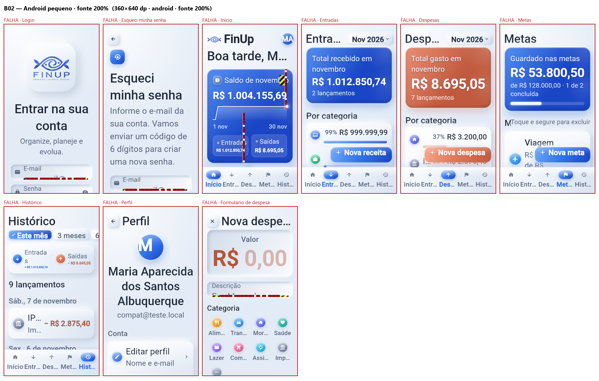
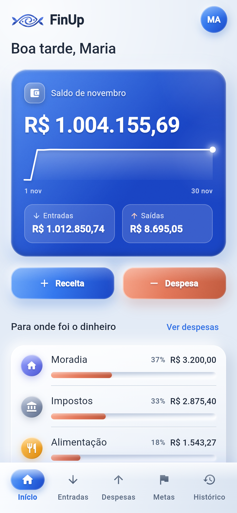
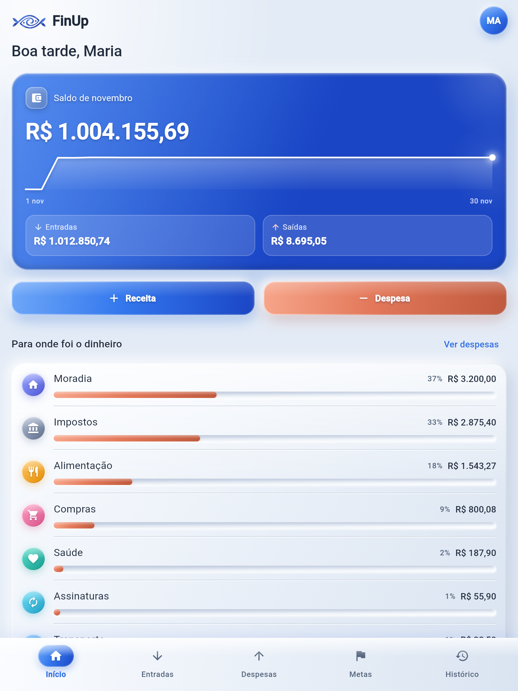
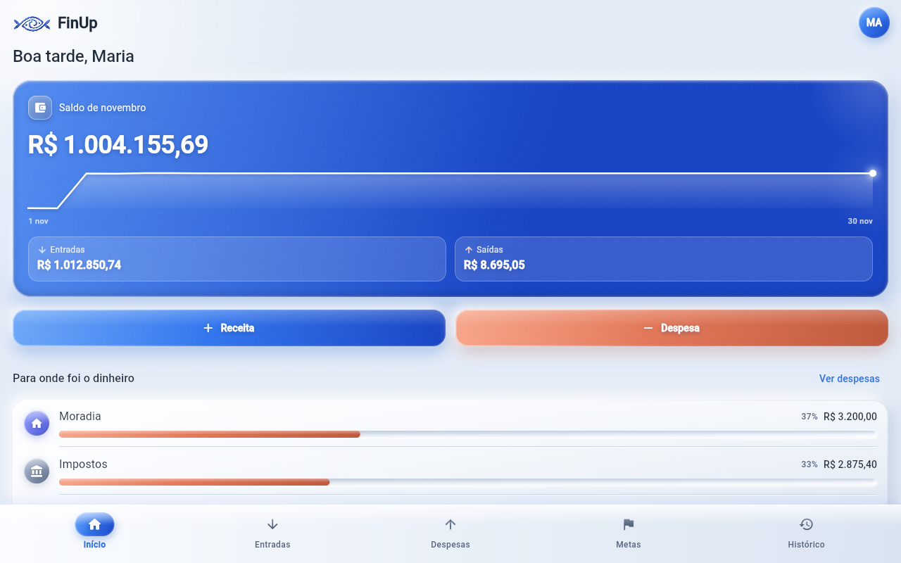
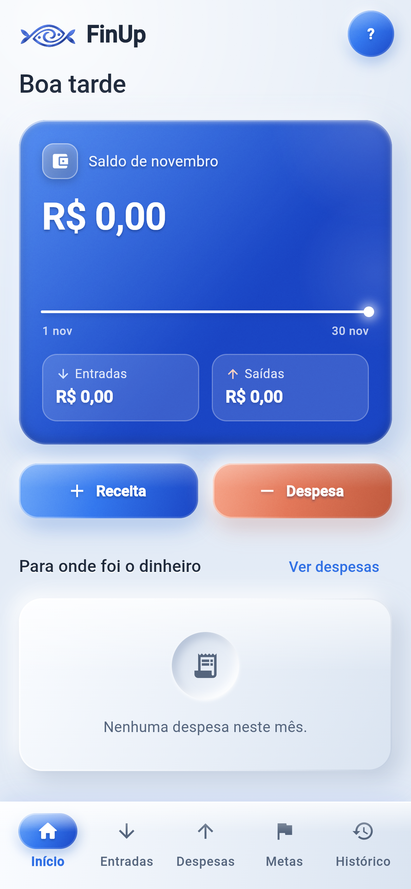

# Relatório de Teste 06 — Teste de compatibilidade: tamanhos de tela e dispositivos

| Item | Valor |
|---|---|
| Projeto | FinUp — Sistema de Gestão Financeira |
| Tipo de teste | Compatibilidade (telas, aparelhos, orientação, acessibilidade, tema, teclado, plataformas e navegadores) |
| Data/hora da execução | 08/11/2026 12:50 a 13:20 (UTC−3) |
| Versão testada | branch `redesign-fusao-tema-escuro`, commit `e1376b8` + alterações locais não commitadas |
| Executado por | millanzz (com apoio do Claude Code) |
| Resultado geral | **Telas: 201 de 222 verificações aprovadas (90,5%)**, com 20 de 24 perfis sem nenhum problema. **Plataformas: os builds Android, Web e Windows compilam e a Web abre em Chrome e Edge**, mas foram encontrados problemas de compatibilidade no **APK de produção** e no **endereço da versão Web**. **3 defeitos novos** (DEF-10 a DEF-12) |


> **Reteste após as correções (2º ciclo).** Este relatório registra o **1º ciclo** de testes, com as falhas como foram encontradas; as evidências dele estão em [evidencias-ciclo1/](evidencias-ciclo1/). Os defeitos foram corrigidos e as baterias foram executadas de novo: os resultados novos estão em [evidencias/](evidencias/) e o comparativo antes × depois, em [../RETESTE.md](../RETESTE.md).

---

## 1. Objetivo

Verificar se o FinUp funciona e se apresenta corretamente em:

- **tamanhos de tela** de 280 a 1.920 dp de largura (celulares compactos, comuns e grandes, dobrável, tablets, notebook e monitor);
- **aparelhos e sistemas**: Android, iOS e Windows/Web, inclusive com notch e barra de gestos;
- **orientação** retrato e paisagem (o app não trava a orientação no Android nem no iOS);
- **acessibilidade**: fonte do sistema em 130% e 200%;
- **tema escuro** e **teclado aberto** nas telas de formulário;
- **plataformas de build** (APK Android, Web, Windows) e **navegadores** (Chrome, Edge).

## 2. Ambiente e limitações

| Item | Detalhe |
|---|---|
| Máquina | Windows 11 Pro 26200 · Intel i5-9400F · 15,9 GB |
| Flutter / Dart | Flutter 3.41.1 (stable) |
| Android SDK | 36.1 (build-tools 36.1.0); **nenhum emulador ou aparelho conectado** |
| Navegadores | Chrome 157.0.8103.38 e Edge 157.0.4341.42 (sem janela, via DevTools Protocol) |
| API | API real do FinUp (`backend/src/app.js`) com banco SQLite de teste |

**Nenhum arquivo do projeto foi alterado.** Os builds geraram arquivos apenas em `frontend/build/`, que é ignorada pelo git.

**Limitações:**

- Não havia celular nem emulador Android disponível, e não é possível compilar para iOS no Windows (precisa de um Mac). Os aparelhos foram **simulados** com o próprio Flutter: as **telas reais** do app foram desenhadas com o tamanho, a área segura (notch e barra de gestos), a plataforma (Android ou iOS), a escala de fonte, o tema e o teclado de cada perfil.
- O APK foi **compilado e inspecionado**, mas não instalado num aparelho.
- O comportamento final em aparelhos físicos (desempenho, teclado real, gestos) deve ser confirmado num celular. Ver a seção 9.

## 3. Como foi feito

### 3.1 Matriz de telas ([compat_test.dart](flutter/compat_test.dart))

Para cada **perfil**, as **10 telas** principais são abertas como um usuário faria (tocando nas abas, no avatar e nos botões):

| # | Tela | Ação principal que precisa poder ser tocada |
|---|---|---|
| 01 | Login | Entrar |
| 02 | Criar conta | Criar conta |
| 03 | Esqueci minha senha | Enviar código |
| 04 | Início | Despesa |
| 05 | Entradas | Nova receita |
| 06 | Despesas | Nova despesa |
| 07 | Metas | Nova meta |
| 08 | Histórico | filtro Tudo |
| 09 | Perfil | Sair da conta |
| 10 | Formulário de despesa | Salvar despesa |

Em cada tela, o teste:

1. **registra qualquer erro de layout** do Flutter (ex.: "RenderFlex overflowed", que é texto ou caixa saindo da área e aparece com faixas amarelas e pretas);
2. **verifica se a ação principal está alcançável**: dá para rolar até ela e ela não fica coberta;
3. **salva uma captura** da tela.

Os dados do usuário de teste foram escolhidos para forçar o layout: nome longo ("Maria Aparecida dos Santos Albuquerque"), descrições longas, valores de até R$ 999.999,99, uma compra em 10x e uma meta com título longo.

### 3.2 Perfis testados

| Grupo | Perfis |
|---|---|
| **A — aparelhos** (fonte 100%, tema claro) | A01 Galaxy Z Fold, tela externa (280×653) · A02 iPhone SE 1ª (320×568) · A03 Android pequeno (360×640) · A04 iPhone SE 2ª/3ª (375×667) · A05 iPhone 14/15 (390×844) · A06 Pixel 7/Galaxy S23 (412×915) · A07 iPhone Pro Max (430×932) · A08 iPhone 14 em paisagem (844×390) · A09 Android em paisagem (915×412) · A10 iPad (810×1080) · A11 Tablet Android 10" (800×1280) · A12 Notebook/Web (1280×800) · A13 Monitor Full HD (1920×1080) |
| **B — fonte ampliada** | Android pequeno, iPhone 14 e Pixel 7, com fonte em 130% e 200% (B01–B06) |
| **C — tema escuro** | iPhone 14 e iPad (C01–C02) |
| **D — teclado aberto** | iPhone SE 1ª, Android pequeno e Pixel 7, só nas telas de formulário (D01–D03) |

### 3.3 Plataformas e navegadores

- `flutter build apk --release`, `flutter build web --release` e `flutter build windows --release`.
- **APK**: permissões e versões de Android lidas do pacote final com `aapt`.
- **Web**: o build real aberto no **Chrome e no Edge** ([navegadores.js](servidor/navegadores.js)) em 3 tamanhos (celular 390×844, tablet 810×1080, desktop 1280×800) e em 3 situações: sem sessão, com sessão e abrindo o endereço `/#/home` direto sem sessão.
- **Windows**: o `.exe` de release foi aberto e capturado, e a janela foi fechada em seguida.

## 4. Resumo dos resultados

| Grupo | Perfis | Verificações (tela × perfil) | Aprovadas | Reprovadas |
|---|---:|---:|---:|---:|
| A — aparelhos | 13 | 130 | 127 | 3 |
| B — fonte ampliada | 6 | 60 | 42 | 18 |
| C — tema escuro | 2 | 20 | 20 | 0 |
| D — teclado aberto | 3 | 12 | 12 | 0 |
| **Total** | **24** | **222** | **201** | **21** |

| Plataforma | Build | Abre e funciona | Observação |
|---|---|---|---|
| Android (APK release) | ✅ 51,6 MB · Android 7.0+ (SDK 24) até SDK 36 · arm64, armv7, x86_64 | ❌ não pôde ser instalado num aparelho; o pacote **não pede permissão de Internet** | **DEF-10** |
| Web (Chrome 157 / Edge 157) | ✅ | ✅ login e Início corretos nos 3 tamanhos e nos 2 navegadores | Endereço `/#/home` abre o app sem login (**DEF-11**) |
| Windows 11 (release) | ✅ | ✅ abre, responde e segue o tema do sistema (escuro) | Título da janela "gestao_financeira" (OBS-11) |
| iOS | — | — | Não testável neste ambiente (precisa de macOS) |

## 5. Resultados por perfil

Cada perfil tem uma **folha de contato** com as capturas de todas as telas, com moldura verde (OK) ou vermelha (FALHA).

| Perfil | Aparelho | Tamanho (dp) | Plataforma | Telas OK | Problemas |
|---|---|---|---|---:|---|
| [A01](evidencias-ciclo1/folhas/A01.png) | Galaxy Z Fold (tela externa) | 280×653 | Android | ❌ 7/10 | Login, Criar conta, Esqueci senha: linha "Ainda não tem conta? Criar conta" estoura 5,6 px |
| [A02](evidencias-ciclo1/folhas/A02.png) | iPhone SE 1ª geração | 320×568 | iOS | ✅ 10/10 | — |
| [A03](evidencias-ciclo1/folhas/A03.png) | Android pequeno | 360×640 | Android | ✅ 10/10 | — |
| [A04](evidencias-ciclo1/folhas/A04.png) | iPhone SE 2ª/3ª | 375×667 | iOS | ✅ 10/10 | — |
| [A05](evidencias-ciclo1/folhas/A05.png) | iPhone 14/15 | 390×844 | iOS | ✅ 10/10 | — |
| [A06](evidencias-ciclo1/folhas/A06.png) | Pixel 7 / Galaxy S23 | 412×915 | Android | ✅ 10/10 | — |
| [A07](evidencias-ciclo1/folhas/A07.png) | iPhone Pro Max | 430×932 | iOS | ✅ 10/10 | — |
| [A08](evidencias-ciclo1/folhas/A08.png) | iPhone 14 em paisagem | 844×390 | iOS | ✅ 10/10 | — |
| [A09](evidencias-ciclo1/folhas/A09.png) | Android em paisagem | 915×412 | Android | ✅ 10/10 | — |
| [A10](evidencias-ciclo1/folhas/A10.png) | iPad 9ª geração | 810×1080 | iOS | ✅ 10/10 | — (ver OBS-10) |
| [A11](evidencias-ciclo1/folhas/A11.png) | Tablet Android 10" | 800×1280 | Android | ✅ 10/10 | — (ver OBS-10) |
| [A12](evidencias-ciclo1/folhas/A12.png) | Notebook / Web | 1280×800 | Windows | ✅ 10/10 | — (ver OBS-10) |
| [A13](evidencias-ciclo1/folhas/A13.png) | Monitor Full HD | 1920×1080 | Windows | ✅ 10/10 | — (ver OBS-10) |
| [B01](evidencias-ciclo1/folhas/B01.png) | Android pequeno · fonte 130% | 360×640 | Android | ✅ 10/10 | — |
| [B02](evidencias-ciclo1/folhas/B02.png) | Android pequeno · **fonte 200%** | 360×640 | Android | ❌ 0/10 | Campos cortados; "Criar conta" fora da tela (a tela de cadastro **não pôde ser aberta**); cartão de saldo estoura em todas as telas logadas |
| [B03](evidencias-ciclo1/folhas/B03.png) | iPhone 14 · fonte 130% | 390×844 | iOS | ✅ 10/10 | — |
| [B04](evidencias-ciclo1/folhas/B04.png) | iPhone 14 · **fonte 200%** | 390×844 | iOS | ❌ 6/10 | Login, Esqueci senha e formulário com campos cortados; "Criar conta" fora da tela (cadastro **não pôde ser aberto**) |
| [B05](evidencias-ciclo1/folhas/B05.png) | Pixel 7 · fonte 130% | 412×915 | Android | ✅ 10/10 | — |
| [B06](evidencias-ciclo1/folhas/B06.png) | Pixel 7 · **fonte 200%** | 412×915 | Android | ❌ 6/10 | Login, Criar conta, Esqueci senha e formulário com campos cortados; "Criar conta" estoura 78 px |
| [C01](evidencias-ciclo1/folhas/C01.png) | iPhone 14 · tema escuro | 390×844 | iOS | ✅ 10/10 | — |
| [C02](evidencias-ciclo1/folhas/C02.png) | iPad · tema escuro | 810×1080 | iOS | ✅ 10/10 | — |
| [D01](evidencias-ciclo1/folhas/D01.png) | iPhone SE 1ª · teclado aberto | 320×568 | iOS | ✅ 4/4 | — |
| [D02](evidencias-ciclo1/folhas/D02.png) | Android pequeno · teclado aberto | 360×640 | Android | ✅ 4/4 | — |
| [D03](evidencias-ciclo1/folhas/D03.png) | Pixel 7 · teclado aberto | 412×915 | Android | ✅ 4/4 | — |

**Exemplo de falha** (B02, fonte 200% em Android pequeno): as faixas amarelas e pretas marcam onde o conteúdo estoura; os campos de e-mail e senha ficam cortados e os rótulos da barra inferior viram "Entr…", "Des…":



**Navegadores** (build Web real): Chrome celular · Edge tablet · Chrome desktop · `/#/home` aberto **sem login** (Chrome celular):

| Chrome 390×844 | Edge 810×1080 | Chrome 1280×800 | `/#/home` sem sessão |
|---|---|---|---|
|  |  |  |  |

## 6. Defeitos encontrados

A numeração continua a dos relatórios anteriores.

### DEF-10 — O APK de produção não tem permissão de Internet: o app instalado não consegue falar com a API

| Item | Detalhe |
|---|---|
| Evidência | `aapt dump permissions app-release.apk` lista só `DYNAMIC_RECEIVER_NOT_EXPORTED_PERMISSION`; **não há `android.permission.INTERNET`** ([apk-release-permissoes.txt](evidencias-ciclo1/plataformas/apk-release-permissoes.txt)) |
| Causa | A permissão está só em `android/app/src/debug/AndroidManifest.xml` e `src/profile/…` (gerados pelo Flutter para desenvolvimento), e não no `src/main/AndroidManifest.xml` |
| Impacto | Funciona no `flutter run` (debug), mas **qualquer APK de release instalado num celular não consegue entrar, cadastrar nem carregar dados**: toda chamada falha com "Não foi possível conectar ao servidor" |
| Severidade | **Alta**: impede o uso do app distribuído |
| Sugestão | Adicionar `<uses-permission android:name="android.permission.INTERNET"/>` em `android/app/src/main/AndroidManifest.xml` e conferir de novo com `aapt dump permissions` |

### DEF-11 — Na versão Web, o endereço da página ignora a sessão

| Item | Detalhe |
|---|---|
| Evidência | Abrindo `http://…/#/home` **sem estar logado**, o app mostra a Início vazia (avatar "?", saldo R$ 0,00); a API responde 401 em `/goals` e o app não volta para o login. Visto no Chrome e no Edge, nos 3 tamanhos ([navegadores.json](evidencias-ciclo1/plataformas/web/navegadores.json)). O inverso também acontece: recarregar a página em `/#/login` com sessão ativa mantém o login na tela |
| Causa | Na Web, o Flutter usa a rota do endereço (`#/home`, `#/login`) como rota inicial. O `initialRoute` do `main.dart`, que decide entre login e Início pela sessão, só vale quando o endereço não tem rota |
| Impacto | Não expõe dados (a API exige token), mas o usuário fica preso num app vazio onde nada funciona, ou precisa entrar de novo sem necessidade depois de recarregar a página |
| Severidade | Média (só na versão Web) |
| Sugestão | Proteger as rotas: em `AppRoutes`/`onGenerateRoute`, redirecionar `/home`, `/perfil` e `/metas` para `/login` quando `AuthService.isLogged()` for falso, e `/login` para `/home` quando for verdadeiro |

### DEF-12 — Com fonte grande (acessibilidade) ou tela muito estreita, campos e textos são cortados e "Criar conta" fica inacessível

| Item | Detalhe |
|---|---|
| Evidência | 21 verificações reprovadas (A01, B02, B04, B06). Diagnóstico do widget que estoura ([diagnostico-overflow.txt](evidencias-ciclo1/diagnostico-overflow.txt)) |
| Causa 1 | `lib/screens/login_screen.dart:169`: a linha "Ainda não tem conta? **Criar conta**" é um `Row` sem quebra. Estoura 5,6 px em 280 dp, 78 px no Pixel 7 com fonte 200% e 130 px no Android pequeno com fonte 200%. **Com fonte 200% em 360 e 390 dp o link "Criar conta" sai da tela e não é possível criar conta.** O mesmo se repete nas telas de cadastro e esqueci a senha |
| Causa 2 | `lib/widgets/fin_controls.dart:242–253`: o `FinField` tem **altura fixa de 58 px**. Com fonte 200%, rótulo + texto não cabem (estouro de 22 px) e o que é digitado fica cortado |
| Causa 3 | `lib/widgets/saldo_card.dart:46` e `:156`: as linhas "Saldo de novembro" e as caixas Entradas/Saídas estouram cerca de 7 px com fonte 200% em 360 dp. Como a Início fica sempre montada, o erro aparece em todas as telas logadas |
| Impacto | Pessoas que usam fonte ampliada no celular (configuração comum entre idosos e pessoas com baixa visão) não conseguem criar conta e veem campos cortados |
| Severidade | Média/alta (acessibilidade) |
| Sugestão | Trocar o `Row` por `Wrap` (ou `Flexible` + quebra de linha); usar `minHeight` em vez de altura fixa no `FinField`; nos cartões, usar `Flexible`/`FittedBox` nos textos. Fonte 130% já passa em todos os aparelhos testados |

## 7. Observações

| ID | Observação |
|---|---|
| OBS-10 | **Sem layout para telas grandes.** Em tablets, notebook e monitor (A10–A13, C02), tudo funciona, mas campos, botões e listas se estendem por **toda a largura** (até 1.920 dp) e a navegação continua sendo a barra inferior de celular. Sugestão: limitar a largura do conteúdo (ex.: `ConstrainedBox(maxWidth: 600)` centralizado) e avaliar `NavigationRail` acima de 840 dp |
| OBS-11 | No Windows, o título da janela é **"gestao_financeira"** (nome do executável), e não "FinUp" como já está no Android, iOS e Web |
| OBS-12 | A versão Web baixa a fonte Roboto de `fonts.gstatic.com` (Google) ao abrir. Em redes que bloqueiam o Google ou sem internet, o app usa uma fonte substituta; e há requisição a um serviço de terceiros. Sugestão: empacotar a fonte nos assets |
| OBS-13 | Paisagem, tema escuro e teclado aberto **não apresentaram nenhum problema** em nenhum perfil testado |
| OBS-14 | O endereço padrão da API no app é `http://10.0.2.2:3000`, que só funciona no emulador Android. Em celular físico é preciso compilar com `--dart-define=API_URL=…` (já documentado em `api_config.dart`). Para produção, a API deve estar em HTTPS |

## 8. Evidências

Na pasta [evidencias-ciclo1/](evidencias-ciclo1/):

| Arquivo | Conteúdo |
|---|---|
| [resultados.md](evidencias-ciclo1/resultados.md) e [resultados.json](evidencias-ciclo1/resultados.json) | Resultado de cada uma das 222 verificações (perfil, tela, erros, ação principal, captura) |
| [folhas/](evidencias-ciclo1/folhas/) | 24 folhas de contato, uma por perfil |
| [telas/](evidencias-ciclo1/telas/) | As 222 capturas individuais (`telas/<perfil>/<tela>.png`) |
| [diagnostico-overflow.txt](evidencias-ciclo1/diagnostico-overflow.txt) | Arquivo e linha do app de cada estouro de layout |
| [plataformas/](evidencias-ciclo1/plataformas/) | Logs dos builds (APK, Web, Windows), permissões e informações do APK, capturas e registro dos navegadores (`web/`) e do Windows (`windows/`) |
| [saida.txt](evidencias-ciclo1/saida.txt), [resultado-testes.json](evidencias-ciclo1/resultado-testes.json), [execucao.txt](evidencias-ciclo1/execucao.txt) | Saídas completas e códigos de saída |

Código: [executar.sh](executar.sh) (matriz de telas), [flutter/compat_test.dart](flutter/compat_test.dart), [flutter/diagnostico_test.dart](flutter/diagnostico_test.dart), [servidor/navegadores.js](servidor/navegadores.js) e [servidor/folhas.py](servidor/folhas.py).

## 9. Como reexecutar

Na raiz do repositório. A matriz de telas leva cerca de 10 minutos:

```bash
bash testes/06-compatibilidade/executar.sh
```

Plataformas (na pasta `frontend`):

```bash
flutter build apk --release
```

```bash
flutter build web --release --dart-define=API_URL=http://127.0.0.1:3999
```

**Recomendado para completar o teste:**

- instalar o APK (depois de corrigir o DEF-10) em pelo menos um celular Android real, ou num emulador criado no Android Studio;
- num Mac, rodar o app num simulador de iPhone, para confirmar o comportamento nativo.

## 10. Conclusão

O FinUp **se adapta bem aos tamanhos de tela comuns**:

- funciona sem nenhum problema de 320 a 1.920 dp de largura, em retrato e paisagem, no tema claro e escuro, com teclado aberto e com fonte em 130%;
- os builds Android, Web e Windows compilam, e a versão Web funciona no Chrome e no Edge.

Os problemas estão em quatro pontos:

1. **APK de produção sem permissão de Internet** (DEF-10): bloqueia a distribuição do app Android e é a correção mais urgente.
2. **Fonte em 200%** (DEF-12): campos cortados e cadastro inacessível para quem usa fonte ampliada.
3. **Rotas da versão Web** (DEF-11): o endereço da página ignora a sessão.
4. **Telas grandes** (OBS-10): o layout ocupa toda a largura e poderia ser melhor aproveitado.
